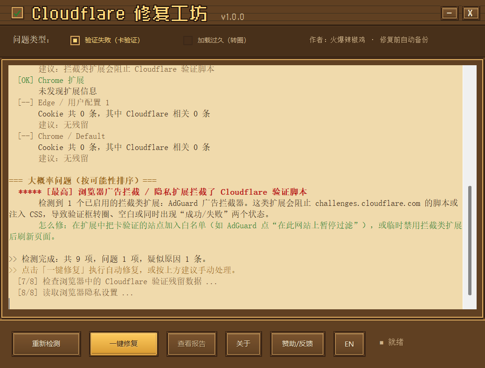
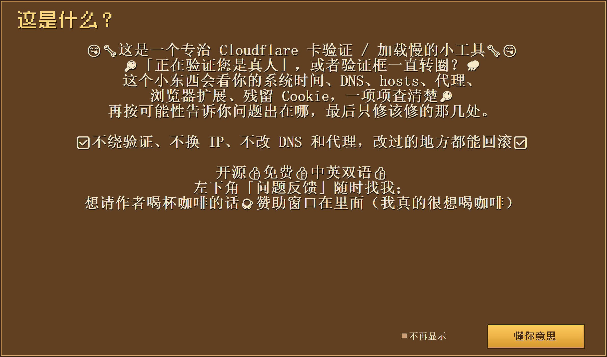

# Cloudflare 修复工坊

这个工具是给自己写的。

登录某个网站，一直卡在「正在验证您是真人」。页面转圈，转完说验证失败。

网上说的办法都试了：关插件、清 Cookie、改 DNS、关代理。试完还是不行，也不知道哪一步有用。

后来想，干脆把可能的原因列出来一条条查。查完告诉我卡在哪，再决定修不修。现在这个工具就是这么干活的。

它查这些：系统时间、DNS、hosts、系统代理、浏览器插件、残留的 Cloudflare Cookie、浏览器隐私设置。如果是加载慢，还会测延迟和 Cloudflare 服务状态。

查到问题后，只改该改的。改之前备份，改完能恢复。它不碰你的 DNS 服务器，不换 IP，不装驱动。

支持 Windows 10/11，双击就能用，不用另外装 .NET。中英文可以切换。



## 两种模式

顶上是两个按钮，选你遇到的情况：

- **验证失败（卡验证）**：验证框出现了，但过不去，或者过完又弹回来
- **加载过久（转圈）**：验证框一直在转，半天没结果

两种模式的检查项不一样。慢加载会多测网络延迟、TCP/DNS 耗时和 Cloudflare 服务状态。

## 怎么用

1. 双击 `CfValidateFixer.exe`
2. 选问题类型，它会自动开始检测
3. 看日志里的结论，按可能性从高到低排
4. 想修就点「一键修复」

修复会做这些事，只做检测出来有问题的：

- 清掉失效的 Cloudflare 验证 Cookie（先备份数据库）
- 刷新 DNS 缓存
- 校准系统时间（偏差超过 5 分钟才动）
- 如果 hosts 里有屏蔽 Cloudflare 的条目，注释掉（先备份原文件）
- 如果系统代理开着但端口连不上，关掉

清理 Cookie 需要先关浏览器。它会问你，选「否」就跳过这一步，其他修复照常。



## 命令行参数

```text
CfValidateFixer.exe                     # 正常启动
CfValidateFixer.exe --mode slow         # 启动就是「加载过久」模式
CfValidateFixer.exe --safe              # 安全模式：只诊断，什么都不改
CfValidateFixer.exe --autofix           # 自动检测 + 修复
CfValidateFixer.exe --autofix --close-browser   # 自动修复，允许自动关浏览器
CfValidateFixer.exe --no-splash         # 不显示启动说明
```

`--safe` 适合先看看它想改什么，或者电脑上不让装来路不明的东西时用。

## 备份和恢复

每次修复前，会把要动的东西备份到程序目录下的 `backup/时间戳/`：

- 浏览器的 Cookies 数据库
- hosts 原文件

主界面有「恢复备份」按钮，恢复最近一次备份。恢复前会关浏览器，hosts 那部分需要管理员权限。

如果程序目录不可写（比如放在 `Program Files`），备份会退到系统临时目录或桌面。

## 会生成哪些文件

| 文件 | 内容 |
|---|---|
| `settings.ini` | 语言、要不要显示启动说明 |
| `feedback.config` | 反馈邮箱配置（发件邮箱和 SMTP 授权码） |
| `sponsor.txt` / `sponsor_en.txt` | 赞助窗口的文案，可以自己改 |
| `修复报告_时间.txt` | 修完之后的报告，写了查到了什么、改了什么 |
| `diagnostic_时间.txt` | 每次检测自动存的诊断日志 |

## 做不到的

- 网站自己配置错了（sitekey 不对、域名没授权），这是站长的事
- Cloudflare 服务器挂了，只能等
- 公司电脑被策略锁死（强制禁用第三方 Cookie），改不动
- 冷门浏览器插件可能识别不出来

这些情况它会直接告诉你，不会假装修好了。

## 常见问题

被杀毒软件拦了、为什么要关浏览器、为什么要管理员权限、怎么换收款码……都写在 [FAQ.md](FAQ.md) 里。

隐私方面的问题看 [PRIVACY.md](PRIVACY.md)：它读什么、不读什么、数据发到哪。

## 从源码构建

需要 .NET 9 SDK。

```powershell
dotnet build -c Release
dotnet publish -c Release -r win-x64 --self-contained true `
  -p:PublishSingleFile=true -p:IncludeNativeLibrariesForSelfExtract=false `
  -p:EnableCompressionInSingleFile=true -p:DebugType=None -o dist
```

单元测试：

```powershell
dotnet test tests/UnitTests
```

## 项目结构

```text
CfValidateFixer.csproj
├── Program.cs            入口、命令行参数
├── MainForm.cs           主窗口、日志、修复流程
├── Diagnostics.cs        检测项
├── FixEngine.cs          修复和报告
├── PixelControls.cs      像素风按钮、标签、单选
├── PixelDialog.cs        自绘弹窗
├── IntroForm.cs          启动说明
├── SponsorForm.cs        赞助窗口（收款码）
├── FeedbackForm.cs       问题反馈
├── AboutForm.cs          关于
├── AppInfo.cs            版本号（改版本只改这里）
├── UserSettings.cs       settings.ini 读写
├── UiScale.cs            高 DPI 缩放
├── assets/               内置收款码
├── fonts/                Zpix 像素字体（自行下载，未附带）
├── tests/UnitTests       单元测试
└── .github/              Issue 模板、CI
```

## 许可证

GPLv3，带 §7 署名保护。详见 [LICENSE](LICENSE) 和 [NOTICE](NOTICE)。

字体用的是 Zpix，作者是 SolidZORO，个人和教学免费，商用要授权，所以源码包里没带字体文件。编译前把 `zpix.ttf` 放进 `fonts/` 目录就行。

## 赞助

软件左下角有收款码，纯自愿，不影响功能。


